<!-- Offscreen Editorial: individually linked panels from the approved illustration. -->

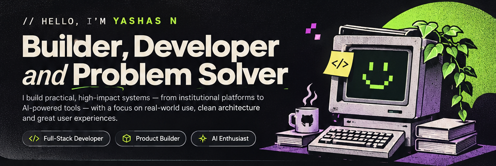

<a href="https://www.linkedin.com/in/yashas-n-b71625310/">LinkedIn</a> · <a href="https://github.com/yashas1519-pixel?tab=repositories">All repositories</a> · <a href="mailto:yashas1519@gmail.com">Contact</a>

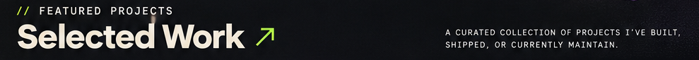

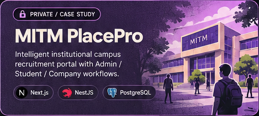 <a href="https://github.com/yashas1519-pixel/nodue-portal">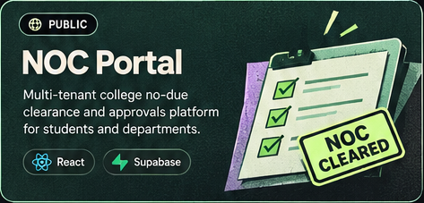</a>

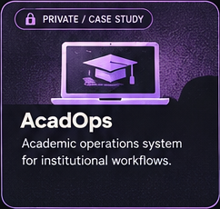 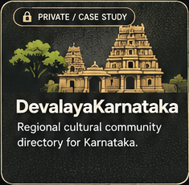 <a href="https://github.com/yashas1519-pixel/Pacha-Cover">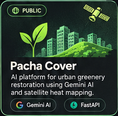</a> <a href="https://github.com/yashas1519-pixel/MentorHub">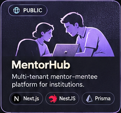</a>

<a href="https://github.com/yashas1519-pixel/contentpilot-ai">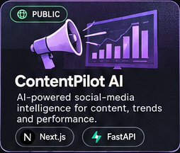</a> <a href="https://github.com/yashas1519-pixel/KSP">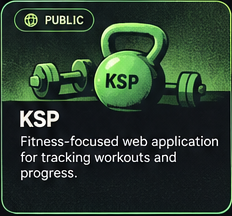</a> <a href="https://github.com/yashas1519-pixel/windows-xp-portfolio">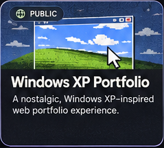</a>

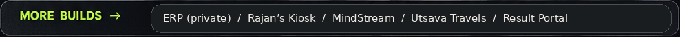

- **ERP** — private institutional software project.
- **[Rajan's Food Truck Kiosk](https://github.com/yashas1519-pixel/rajans-food-truck-kiosk)** — self-service ordering and kitchen management.
- **[MindStream](https://github.com/yashas1519-pixel/lumnia-)** — conversational AI with response telemetry.
- **[Utsava Travels](https://github.com/yashas1519-pixel/Utsava-Travels)** — travel-services website.
- **[Result Portal](https://github.com/yashas1519-pixel/result-portal-firebase)** — academic results application.

Private case studies are intentionally high-level. Project artwork is illustrative, not screenshots of private systems.

<a href="https://github.com/yashas1519-pixel?tab=overview">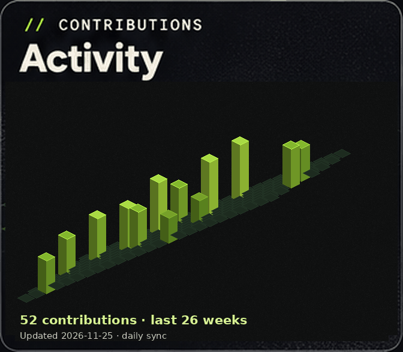</a> <a href="challenge/README.md">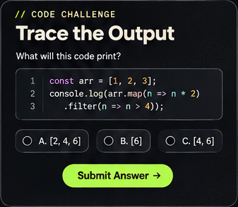</a> <a href="https://github.com/yashas1519-pixel/yashas1519-pixel/issues/new?title=Guestbook%3A%20Hello%20Yashas&amp;body=Say%20hello%20or%20share%20what%20you%20are%20building%21">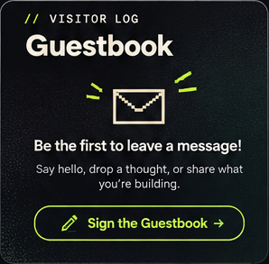</a>

<a href="challenge/README.md">Play the puzzle</a> · <a href="guestbook.md">Read the guestbook</a> · Activity refreshed by GitHub Actions once enabled.

